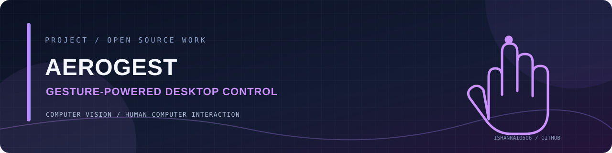

<!-- PROJECT BANNER -->
<div align="center">



# AeroGest

### Webcam-based gesture control

AeroGest is a webcam-based gesture-control project built for a VIT Bhopal project exhibition. It explores hands-free interaction with desktop controls through real-time hand gestures.

<p>
  
  
</p>

</div>

---

## ✨ What it does

<div>

**01 / Mouse movement**  
Control pointer movement using gestures.

</div>
<div>

**02 / Click actions**  
Trigger mouse clicks through hand gestures.

</div>
<div>

**03 / Volume control**  
Adjust system volume with gestures.

</div>
<div>

**04 / Brightness control**  
Adjust screen brightness with gestures.

</div>

## 🧰 Tech stack

Python · Computer Vision · Hand Gesture Recognition

## 🚀 Getting started

### Prerequisites

Python and the project dependencies are required.

### Installation

```bash
git clone https://github.com/IshanRai0506/AeroGest.git
cd AeroGest
pip install -r requirements.txt
python main.py
```


## 📝 Notes

The project README identifies this as a team exhibition project and credits the listed developers and mentor.


## 🤝 Contributing

Ideas, bug reports and thoughtful improvements are welcome. Open an issue to discuss a change before submitting a pull request.

## 👨‍💻 Maintainer

**Ishan Rai** · [GitHub](https://github.com/IshanRai0506) · [LinkedIn](https://linkedin.com/in/ishanrai-tech)

---

<div align="center">

*Built with curiosity. Improved one commit at a time.* ✨

</div>
